<h3><strong>Gabriel Coronel</strong></h3>
<h3>AI Solutions Engineer &amp; Automation Lead</h3>

<strong>Artificial Intelligence · Automation · Software Engineering</strong>

 

<strong>Building smarter operations with AI</strong>

 

---

## About me

I am an AI, automation, and business operations professional based in Buenos Aires, Argentina. I combine technical execution with a business-first perspective to turn operational challenges into practical, measurable solutions.

- 🤖 Building AI-powered tools, automation workflows, and internal platforms
- 🧠 Working with LLM applications, RAG, embeddings, prompts, and AI agents
- 📊 Improving operational visibility through dashboards, KPIs, SLA analysis, and data-driven decision-making
- 🛠️ Translating business requirements into reliable Python applications, APIs, and scalable workflows

## Programming Languages

   

Currently expanding my C# and .NET development skills.

## Core Expertise

`Generative AI` · `AI Automation` · `Python` · `Flask` · `RAG` · `LLMs` · `Embeddings` · `REST APIs` · `SQL` · `Power BI` · `Dashboards` · `Process Improvement` · `Business Operations`

## What I Build

### Operational Intelligence & SLA Monitoring
Tools that centralize operational data, track KPIs and service-level performance, and help teams identify risks and prioritize actions.

### Document Intelligence Assistants
AI-powered knowledge assistants that use retrieval-augmented generation to analyze documents, answer questions, and provide structured summaries.

### AI Automation Workflows
Practical automations that connect systems, reduce repetitive work, improve reporting, and support faster business decisions.

## Currently Exploring

- C# and .NET development
- Agentic AI workflows and AI-assisted development
- Reliable RAG architectures and local AI models
- AI product prototyping for business operations
- Robotics, embedded systems, and human-centered AI

## Let's Connect

- 🌐 Portfolio: [gabrielcoronel.netlify.app](https://gabrielcoronel.netlify.app)
- 💼 LinkedIn: [linkedin.com/in/gycoronel](https://www.linkedin.com/in/gycoronel)
- 📍 Buenos Aires, Argentina

## Featured repositories

- [Auralis](https://github.com/2506ga/auralis)
- [Telegram Gemini Business Automation](https://github.com/2506ga/telegram-gemini-business-automation)

## GitHub activity

